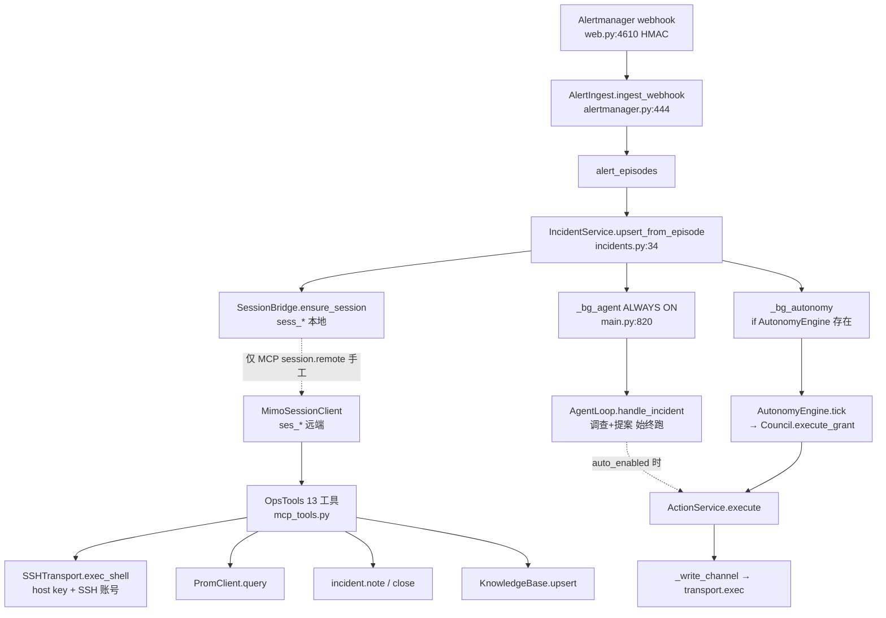

# P4 前置架构审查报告

> 范围：只调查/验证/报告。**未改业务代码、未实施 P4、未删 Council、未升级库、无生产写操作。**  
> 基线：`speed-supreme` @ `acdbacf` · schema v18 · MCP 13 工具 · `auto_remediation_enabled=False`  
> 证据标注：`[代码已证实]` `[实测已证实]` `[设计建议]` `[待验证]`

---

## 0. 工作树核实

| 项 | 结果 | 标注 |
|----|------|------|
| 目录 | `C:\Users\karory\Git\Ayana-speed-supreme`（worktree） | [代码已证实] |
| 分支 / HEAD | `speed-supreme` / `acdbacf` | [代码已证实] |
| 远端 | `origin/speed-supreme` 同步，工作区 **clean** | [代码已证实] |
| `ayana/mimo_session.py` | 存在，7304 B，`ast.parse` 通过，`create/resume` 可导入 | [代码已证实] |
| 三条工具报错 | `ChildProcess.kill` / `mimo_session.py not found` / `old_string identical` 均为**瞬时工具误报**，磁盘与运行结果完好（P3 E2E 九项已过） | [实测已证实] |

---

## 1. 当前执行链拓扑



| 跳 | 状态 | 标注 |
|----|------|------|
| 告警→Incident | **已接通**（webhook + 60s reconcile） | [代码已证实] `web.py:4610` `main.py:796` |
| Incident→本地 Session | **已接通**（`_touch_session` 自动） | [代码已证实] `incidents.py:25` |
| Session→MiMo 远端 | **仅手工 MCP**，无自动 `attach_remote/prompt_remote` | [代码已证实] grep 仅 `mcp_tools.py:551-558` |
| MiMo→MCP | 工具面完整 13 个 | [实测已证实] P3 E2E |
| MCP→SSH | `exec_shell` 有 host key / 账号校验 | [代码已证实] `transport.py:492` |
| 审批→执行→验证→审计 | ActionService FSM 完整 | [代码已证实] `actions.py:973+` |
| 验证成功→知识 | `knowledge.upsert` 可用 | [实测已证实] P1 验收 |

**结论：无人值守闭环在「Session→MiMo 自动调查」处断开。** [代码已证实]

---

## 2. 写操作入口与安全检查矩阵

| 入口 | 链 | Policy | 审批 | 审计 | session_write_ops | 备注 |
|------|----|--------|------|------|-------------------|------|
| Web `/api/actions/{id}/execute` | `api_action_execute`→`ActionService.execute` | 可选 | **是** | **是** | **否** | [代码已证实] `web.py:215` |
| AgentLoop `_auto_dispatch` | 仅 `auto_enabled` | 是 | 视 rule | 是 | **否** | [代码已证实] `agent.py:407` |
| Autonomy `execute_grant` | `_bg_autonomy` | 是 | 双席/人工 | 是 | **否** | [代码已证实] `council.py:424` |
| MCP `host.exec` | `exec_shell` | **否** | **否** | 部分 | **否** | [代码已证实] `mcp_tools.py:300` — 权限=SSH 账号 |
| promconfig 安装/控制 | 多处 `transport.exec` | 否 | 否 | 部分 | **否** | [代码已证实] `promconfig.py:1657-2160`；`_retry_exec` **盲重试×3** `:884-893` |
| terminal.py / nodewatch / checks | probe 为主 | — | — | — | 否 | [代码已证实] |
| `send_file` | `transport.send_file` | 否 | 否 | 否 | 否 | [代码已证实] `transport.py:654` |

**要点**
1. `session_write_ops` 目前是**台账接口**，**未强制覆盖任何执行路径**。[代码已证实]
2. ActionService 自带 FSM 防重放：`unknown/dispatched/success/…` 拒重放（`actions.py:57,1011-1013`）。[代码已证实]
3. MCP `host.exec` 是**通用写口**，安全边界=SSH 账号+host key，无 claim_write。[代码已证实]

---

## 3. 旧 Council 去留清单

### 3.1 触发面（不能只看 `auto_remediation_enabled`）

| 触发 | 位置 | 实际行为 | 标注 |
|------|------|----------|------|
| `_bg_agent` **始终启动** | `main.py:820-824` | 只读调查+LLM 分析+提案；仅 `_auto_dispatch` 查 `auto_enabled` | [代码已证实] |
| `_bg_autonomy` | `main.py:666,851-871` | `autonomy.tick`/`poll_verifications`；门是 `autonomous_agent.enabled` | [代码已证实] |
| `AutonomyEngine.enabled` | `autonomy.py:156` = providers 开关 | **与 `auto_remediation_enabled` 独立** | [代码已证实] |
| `writes_enabled` | `autonomy.py:160` = `agent.auto_enabled` | 写被 `auto_remediation_enabled`/`agent_auto_enabled` 挡 | [代码已证实] |
| Web `/api/agent/auto` | `web.py:285,3963` | 可**运行时打开** meta `agent_auto_enabled=1`，覆盖配置默认 False | [代码已证实] |
| `/api/incidents/*/council/*` | `web.py:201-205` | 人工裁决/屏障仍在 | [代码已证实] |
| QQ `/investigate` | `qqbot.py:458` | 手动只读调查 | [代码已证实] |
| MCP | — | **无** council/autonomy 触发 | [代码已证实] |

> **风险结论**：`auto_remediation_enabled=False` **不能**证明旧 Council 已隔离——`_bg_agent` 常驻提案、`autonomous_agent.enabled` 可独立开读链、Web 开关可运行时打开写链。[代码已证实]

### 3.2 组件去留

| 组件 | 裁定 | 说明 |
|------|------|------|
| `council.py` | **删** | 双席编排 |
| `autonomy.py` | **删** | AutonomyEngine + `autonomy_state` |
| `ai_providers.py` | **删** | planner/reviewer_kimi/deepseek + 花费台账 |
| `agent.py` AgentLoop | **删**（提案 UX 可迁） | 旧自动闭环 |
| `investigation.py` | **迁/留** | 只读证据环可给 MiMo 复用 |
| `runbook.py` | **迁/留** | 规则匹配 vs 人工模板拆分 |
| `actions.py` | **留+瘦身** | 审计/验证保留；去 `mode=reviewed`、`council_grant_*` |
| `approval.py` / `policy.py` / `capabilities.py` | **留** | 人工审批与权限面 |
| `transport.py` / `knowledge.py` / `incidents.py` / `llm.py` | **留** | 新链共用底座 |

### 3.3 数据与配置

- **删/停用**：`council_*`、`ai_provider_*`、`ai_calls`、`autonomy_state`（表可先停写后归档）。[代码已证实] `db.py:852-916`
- **保留**：`actions` `investigations` `verifications` `permissions` `agent_ceiling` + 全部审计。[代码已证实]
- **配置**：`auto_remediation_enabled`（默认 False）、`autonomous_agent.enabled`（默认 False）；密钥 `ai_*_api_key` 不入库。[代码已证实] `config.py:44-46,80-83`

---

## 4. 幂等与状态机风险（高→低）

| # | 严重度 | 风险 | 证据 | 标注 |
|---|--------|------|------|------|
| 1 | **高** | `promconfig._retry_exec` 盲重试 3 次；timeout 后重试可能双写（restart/覆盖文件） | `promconfig.py:884-893` | [代码已证实] |
| 2 | **高** | `session_write_ops` **无 `unknown` 态**；`complete_write(ok=False)` 把超时标成可重试 `failed` | `session_bridge.py:402-412` | [代码已证实] |
| 3 | **高** | `claim_write` 重试竞态：`released/failed`→claimed 的 UPDATE **无状态谓词**，并发双 claim | `session_bridge.py:385-390` | [代码已证实] |
| 4 | **中** | ActionService / MCP `host.exec` / promconfig **都不走** `claim_write`，台账是装饰 | `actions.py:973+` `mcp_tools.py:300` | [代码已证实] |
| 5 | **中** | 重启后 `claimed` 无人释放 → 永久卡住，或手动 release 后重放可能已成功的写 | `session_bridge.py:372`；重启路径 `main.py:606` 不处理 | [代码已证实] |
| 6 | **中** | MCP `host.exec` 无幂等键；MiMo 断线重试可重复写 | `mcp_tools.py:300` | [代码已证实] |
| 7 | **低** | `claimed` 无租约/TTL | `session_bridge.py:372` | [代码已证实] |
| 8 | **低** | ActionService FSM 本身健全：timeout/SSH 断→`unknown`、`no_replay_unknown`、重启 `dispatched→unknown` | `actions.py:2077,1011,1833` | [代码已证实] |

**红线**：执行结果 **unknown ≠ failure**。禁止未核验状态就重放可能已成功的写。  
ActionService 已遵守；`session_write_ops` **尚未遵守**。[代码已证实]

---

## 5. 无人值守调查闭环缺口

目标链：`告警 → Incident → Session → MiMo 调查 → 证据 → 结论 → Incident 更新`

| 环节 | 状态 | 说明 |
|------|------|------|
| 告警→Incident | **已实现** | webhook + reconcile |
| Incident→本地 Session | **已实现** | `ensure_session` 自动 |
| 自动创建远端 MiMo Session | **缺失** | 仅 `session.remote` MCP 手工 |
| 自动下发调查 prompt | **缺失** | `prompt_remote` 无自动调用方 |
| 超时/重试/并发限制 | **部分** | mimo 子进程有 timeout；无并发上限/退避 |
| 上下文隔离 | **已实现** | 本地+远端按 incident 隔离（P3 实测） |
| Session 生命周期 | **已实现** | 映射/历史/失效重建（P3） |
| 失败恢复 | **部分** | 远端失效可重建；调查中断无续跑 |
| 事件状态推进 | **部分** | note/close 可用；无自动结论→stage 推进 |
| 证据→知识自动入库 | **接口已有** | `knowledge.upsert`；无自动调用 |

**当前 `_bg_agent` 仍在跑旧调查+提案**，与新 MiMo 路径并行，属过渡双轨。[代码已证实]

---

## 6. P4 实施设计（待你确认，本轮不实施）

### 6.1 退出主路径
1. 停止 spawn `_bg_autonomy`；`AutonomyEngine`/`CouncilService`/`ProviderRegistry` 不再构造。[设计建议]
2. `_bg_agent` 改为：只做事件对账/提案关闭，或整段删除改由 MiMo 接管。[设计建议]
3. Web `/api/autonomy/*` `/api/incidents/*/council/*` 改 410 或只读快照。[设计建议]
4. `POST /api/agent/auto` 移除或改为显式实验开关+审计。[设计建议]

### 6.2 保留通用件
`SSHTransport` `KnowledgeBase` `IncidentService` `ActionService(瘦身)` `approval` `policy` `capabilities` `investigation(只读)` `runbook(人工模板)` `llm`。[设计建议]

### 6.3 ActionService 统一幂等闸
- `execute()` 入口先 `claim_write(incident_id, action_key)`；`action_key` 建议 `action:{action_id}` 或 `{asset}:{object}:{verb}:{params_hash}`。[设计建议]
- `session_write_ops` 增加 **`unknown`** 态；timeout/断连→`unknown`，**禁止自动重试**。[设计建议]
- claim UPDATE 加 `AND status IN ('released','failed')` 谓词，杜绝并发双 claim。[设计建议]
- 重启扫描：`claimed` 超过租约 → 置 `unknown`（不自动重放）。[设计建议]

### 6.4 未知结果处理
1. 派发前状态标记 `dispatched`。  
2. 连接失败/timeout/负 rc → `unknown`。  
3. **先核验**（`systemctl show`/端口/指标）再决定 success/failure。  
4. 人工 `adjudicate`（已有 `actions.py:1864`）或安全探测后单次重放。[设计建议]

### 6.5 状态衔接
`Incident(status,stage) ↔ Session(local,remote) ↔ Execution(action.state / write_ops.status)`  
统一映射表建议落在 `incident_session` + `session_write_ops`，不新建第三套状态机。[设计建议]

### 6.6 自动调查起停
- 起：`upsert_from_episode` 成功且 `auto_investigate=True` → `ensure_session` + `attach_remote` + `prompt_remote`（带并发上限与节流）。[设计建议]
- 止：远端返回结论 → `incident.note`；满足验证 → `knowledge.upsert`；超时/失败 → `need_human`。[设计建议]
- 旧 `_bg_agent` 与新链互斥，防双写。[设计建议]

### 6.7 审批/Policy/SSH/审计
不弱化：Action 路径仍走 policy+approval+audit；MCP `host.exec` 保持 SSH 账号边界并补 `claim_write` 与审计字段。[设计建议]

### 6.8 迁移与回滚
- **DB**：v19 仅加 `session_write_ops.unknown`/租约列；council 表**先停写**，v20 再归档删除。[设计建议]
- **回滚**：feature 开关 `legacy_agent_loop`；保留 git revert 点；council 表未删前可回切。[设计建议]

### 6.9 实施顺序与验收

| 步 | 内容 | 验收 |
|----|------|------|
| P4.1 | 幂等闸+unknown 态+竞态修复 | 并发/超时/重启单测绿 |
| P4.2 | ActionService 接入 claim_write | 全写路径有台账 |
| P4.3 | 自动调查桥（attach+prompt 限流） | 模拟告警→会话→note 全链 |
| P4.4 | 停 _bg_autonomy / 拆 Council 入口 | 回归绿、无双轨 |
| P4.5 | 清 UI/API/表说明 | 无旧编排入口 |

---

## 7. 测试与验收计划

**新增单测**：claim 并发双写、timeout→unknown、重启 claimed→unknown、unknown 不重放、自动调查限流、Council 移除后回归。  
**集成**：模拟 Alertmanager webhook→session.remote→host.exec(read)→note；不制造生产故障。  
**全量**：现有 1238 + 新增；迁移兼容 v18→v19。  
**实测**：P3 E2E 脚本保留为 MiMo 链冒烟。

---

## 8. 当前 Git 状态

```
分支 speed-supreme · HEAD acdbacf · clean · 与 origin/speed-supreme 同步
P0 ffbd512 → P0fix c16cb20 → P1 bd3e66e → P1fix 86c3464 → P2 126353e → P3 acdbacf
```
本报告为审查产物；**无业务代码变更**。

---

## 9. 本轮明确未做

- 未修改 `ayana/` 业务代码  
- 未删除 Council / 未升级 schema / 未开生产写  
- 未进入 P4 实施  

**等待确认后再开工 P4。**
