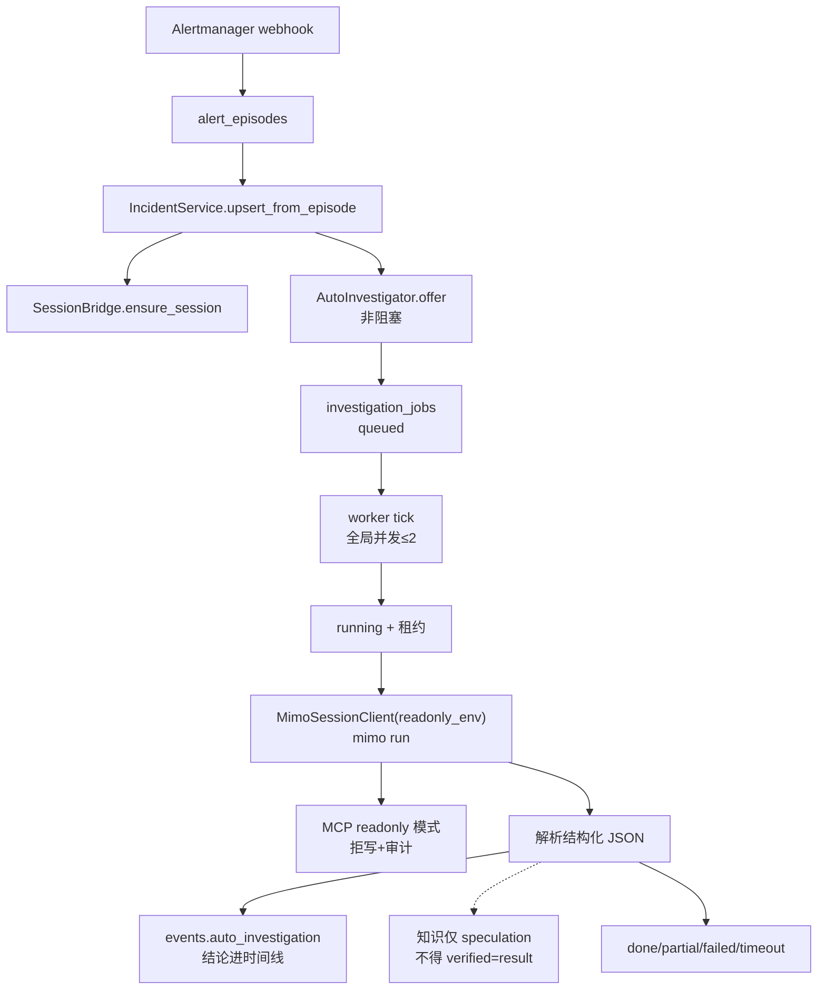

# P4.3 交付报告 — 无人值守只读调查闭环

> `3c764bd` → `8f90eee` · schema v20 · **未开自动修复、未启 Council、未进 P4.4**

---

## 1. 实际调用链与状态流转



| 状态 | 含义 |
|------|------|
| `queued` | 待调查（offer 幂等入队） |
| `running` | 租约占用中 |
| `done` / `partial` | 结论已写时间线 |
| `failed` / `timeout` | 结束且进冷却，不自动重试 |
| 租约过期（重启） | → `failed`，不永久卡死 |

---

## 2. 触发与调度

| 能力 | 实现 | 验证 |
|------|------|------|
| 新 Incident 自动入队 | `_touch_session` → `offer()` | [代码已证实] |
| 重复 firing 不重复启动 | 同 generation `queued/running/done/partial` → `noop` | 单测 |
| 运行中不并发二轮 | `per_incident_concurrent=1` + 状态机 | 单测 |
| 复发 generation 重新调查 | `requeued` + generation 递增 | 单测 |
| 重启恢复 | `recover()`：running+租约过期→failed | 单测 + kanata |
| 不阻塞告警 | `offer` try/except，主流程无感 | [代码已证实] |
| 独立开关默认关 | `auto_investigate.enabled=False` | kanata 日志 |

**并发/超时/轮次/冷却**均可配置，默认保守：`max_concurrent=2, timeout_sec=300, max_rounds=3, cooldown_sec=60`。

---

## 3. 只读边界（执行层，非提示词）

| 控制 | 位置 | 证据 |
|------|------|------|
| `OpsContext.readonly` | `mcp_tools.py` | 单测 |
| host.exec 写/未知 → 拒 | `readonly_mode_rejects_write` | 单测 + kanata |
| shell 包装/重定向/管道/sed -i/sudo → 拒 | `classify_shell_command` | 单测 |
| knowledge.upsert / incident.close → 拒 | 同上 | 单测 |
| 拒绝写审计 | `audit_log.mcp_host_exec_write` | 单测 |
| 会话级 env | `AYANA_MCP_READONLY=1` 注入 mimo 子进程 | [代码已证实] |
| 只读命令仍走 host key / 分类 / SSH 账号 | 复用 P0/P4.2 | 未削弱 |

---

## 4. 证据与结论

结构化 JSON：`status / symptoms / facts[] / hypotheses[] / unconfirmed[] / next_steps[] / root_cause`。

- 事实 vs 推测 vs 建议分字段；**无证据 root_cause 强制 `unknown`**
- 结论写入 `events.auto_investigation`（保留轮次历史，不覆盖）
- MiMo 输出非 JSON → `partial` + `raw_excerpt`，**不伪造成功**
- **调查完成 ≠ 恢复**：不自动 close 仍 open/firing 的事件（单测锁住）

---

## 5. 知识库联动

- 自动调查若写知识，`verified=result` **强制降为 `speculation`**（无人执行修复）  
- 复用 P1 `upsert`，不可污染 verified 文档  
- 写失败只记日志，不阻塞 Incident  

---

## 6. 测试结果

| 范围 | 结果 |
|------|------|
| P4.3 专项 | **24 OK** |
| P4.0–P4.2 + P0–P3 专项 | 101 OK |
| **全量** | **1291 OK**（skip=2） |
| kanata 冒烟 | schema 20 · auto_investigate=disabled · offer 幂等 · readonly 拒写 · 只读可执行 · legacy 仍关 **PASS** |

验收对照：1 新告警入队 / 2 重复不启 / 3 并发隔离 / 4 并发上限 / 5 超时结束 / 6 失败+冷却不无限重试 / 7 重启恢复 / 8 拒写 / 9 事实推测分离 / 10 时间线 / 11 知识不污染 / 12 不自动关闭 / 13 Council 仍禁用 / 14 无回归。

---

## 7. 文件与迁移

**新增** `ayana/auto_investigate.py` · `tests/test_p4_3_auto_investigate.py`  
**修改** `config.py` `db.py`(v20) `incidents.py` `main.py` `mcp_tools.py` `mcp_server.py` `mimo_session.py` `session_bridge.py`

- **v20**：`investigation_jobs` 表，幂等创建，旧数据兼容  
- 回滚：`auto_investigate.enabled=false`（默认）即可；`git revert 8f90eee`

---

## 8. Git

```
8f90eee P4.3: 无人值守只读调查闭环（调度/只读闸/结论/知识纪律）  ← 已推送
```
工作区 clean。

---

## 9. 遗留风险与 P4.4 前置

1. **生产未开启** `auto_investigate`——验收用模拟+冒烟；正式启用需再观察一轮。  
2. 自动调查依赖 `mimo run` + plan key；额度/网络失败已收敛为 failed，但无指标告警。  
3. 结论 JSON 由模型输出，字段偶发缺失已用 `unknown`/`partial` 兜底，但非 schema 强校验。  
4. 知识自动沉淀默认关闭（`knowledge_write.enabled`），避免推测入库。  
5. 旧 Council 代码仍在（P4.4 拆）。

**P4.4 前置**：本闭环只读且有界；可安全拆除 `_bg_agent`/Council 代码路径，不影响调查能力。
