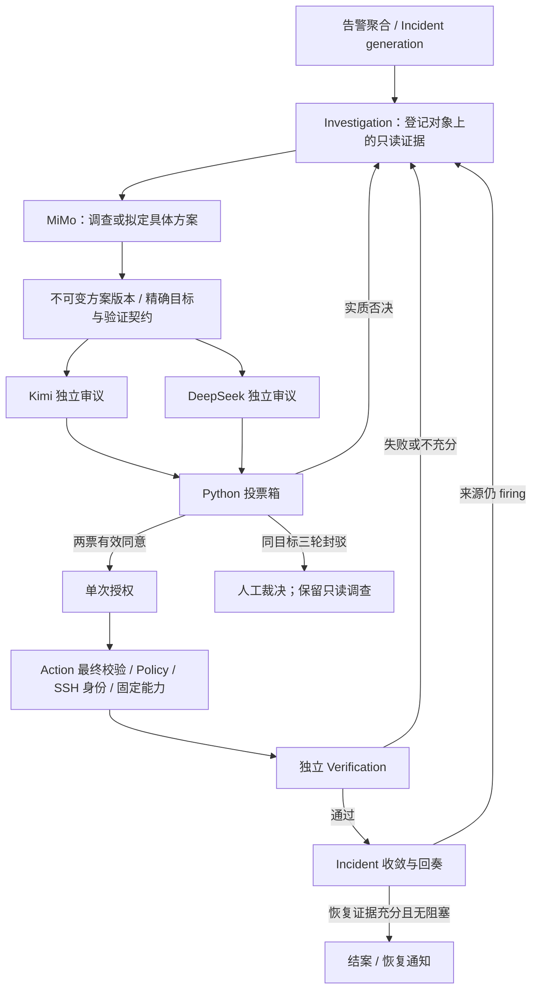

# 三省制自治 Agent：实现、配置与验收

本次实现基于现有 `IncidentService`、`InvestigationService`、`Policy`、`ActionService`、Verification 和 Notifier。新模型默认关闭，不部署到生产、不自动扩大主机权限。

## 现状审查与实施结果

原 Agent 已有受 Policy 约束的只读调查、确定性 Runbook、人工批准、SSH 身份校验、验证、事件代次和通知补偿。本次复用这些能力，没有增加自由 shell 执行器。原先的主要缺口是：

- 单一 LLM 主要做建议，只有 Runbook 能决定自动操作。
- 没有独立委员、不可变方案、双票和一次性细粒度授权。
- Runbook 等待、旧 `no_runbook_match` 人工义务与验证状态可能阻碍后续调查或结案。
- 没有跨模型的凭据隔离、用量和共享费用预算。

四阶段均已有实际代码和本地测试：

| 阶段 | 实现 |
| --- | --- |
| 一：角色与接入 | `ai_providers.py`：三个独立角色、加密密钥、热更新、官方账户模型核验、严格 JSON |
| 二：审议与执行 | `council.py`、数据库迁移 16、Action `reviewed` 模式：并行两席、确定性投票、单次逐步授权 |
| 三：调查与闭环 | `autonomy.py`：自主选读工具、封驳反馈、不同策略、验证反馈、持久人工屏障、代次隔离 |
| 四：运行与展示 | 主程序独立 worker、现有 Incident UI、通知补偿、费用账本、重启恢复和端到端故障注入 |

## 责任与状态



底层阶段使用 `received`、`investigating`、`drafting`、`reviewing`、`approved`、`rejected`、`executing`、`verifying`、`reporting`、`closed`，另有 `manual`、`watching`、`provider_unavailable`、`budget_blocked`。中文历史名称只用于显示。

- **Incident** 管故障生命周期、generation、来源和恢复证据；模型不能宣布结案。
- **Investigation** 管登记对象、只读目录、Policy 与证据。Planner 只提交工具选择，没有 SSH/Action 写工具。
- **ProviderRegistry** 管三个独立客户端、密钥、超时、重试和费用；没有写执行权。
- **Council** 管方案版本、两席身份、审议票、封驳计数和一次性授权。模型不能声明自己是哪位委员，也不能更改票或权限。
- **Action** 是唯一写通道，真正派发前再次检查所有安全边界；命令返回成功只进入验证。
- **Verification** 使用绑定在方案中的现有后端契约；模型描述的验证不能取代实际验证器。
- **Notifier** 复用 QQ/企微通道，持久补偿人工裁决和关键暂停通知，结案继续使用现有恢复通知。

## 调查、Runbook 与人工交接

每次自治处理只进行有界工作，进度与下次重试时间持久化。`watching` 和技术性 `need_human` 不会被扫描器全局忽略。已获权限、前置条件满足的已知 Runbook 仍走原快速路径；自治路径每代只为它让出一次处理窗口，不能因为“匹配了规则”无限等待。

同一对象同一能力的 Runbook 和会审执行共用冷却/次数账本；失败和 unknown 也计数。重启到上限后仍能看日志、配置属性、进程和端口，并送审 `service.reset_failed` 或 `service.reload` 等不同能力。每个新能力仍须明确 Policy 许可、验证 profile 和主机权限。能力目录目前不接受模型任意 shell 或文件改写，也不能用改命令字符串绕过同一能力的预算。

已尝试且失败的完整策略会反馈给 Planner；已完成的完整策略也不重复送审。签名只按规范化能力和参数计算，忽略生成的步骤序号、文字及步骤顺序。验证失败重新调查；未知写操作、人工拒绝、未完成写入和待验证操作停止新写，继续进行固定有界只读观察。

同一服务恢复目标由服务器按 Incident、generation、资产、对象确定，模型不能通过重命名目标清零封驳次数。三轮有效封驳后，或 Planner 主动要求人工时，建立持久屏障。管理员在事件详情点击“允许此目标重新拟案”，只解除这一目标的屏障，新方案还要重新两票审议；unknown 和明确人工拒绝继续由原人工处置流程核清。

Policy 不允许的新方案也会转人工裁决，显示阻碍与调查证据。两票不覆盖人工审批要求；管理员可用现有人工操作或权限配置决定后续处置。新模型不能自己改 Policy。

后续同代同目标的新方案独立验证全部通过后，只精确核销旧 `verify_failed` / `verify_inconclusive` 技术义务及旧路径自动产生的 `no_runbook_match`。人工决定、Policy 拒绝、unknown、其他对象和其他代次不清除。来源仍在 firing 时不能仅凭 SSH 成功或单个通过标记强行结案。

## 配置与启用

1. 在现有 Web 全局设置打开“三省制自治 Agent”配置。三家独立填写官方 Base URL、模型、Key、超时、重试与价格。Key 仅写入，经现有 AES-GCM 加密存储；原 `llm_*` 分析设置继续保留。
2. 执行每个角色的账户模型核验。2026-10-21 使用用户提供的三个新 API 凭据做官方 `/models` 只读验证，实际支持 `mimo-v2.6-pro`、`kimi-k2.6`、`deepseek-v4-pro`。这次核验使用临时数据库，不修改运行实例的配置，不把 Key 写进仓库。
3. 设置总预算，首期默认人民币 100 元；按已确认的官方人民币价格填写每百万输入/输出 Token 单价。价格未知时不发起收费调用。缓存、时段和账户折扣可能使账单不同，界面显示的是 usage 乘配置价格的费用估算。
4. 先保持自治关闭，核对登记对象、Agent ceiling、`auto_rule:agent` 的读写 Policy、主机指纹与 SSH 受限账号。新增 reload/reset-failed 没有自动向主机授予 sudo/forced-command 权限。
5. 启用新自治开关后可进行调查；真正自动写还必须开启原“自动处置”总开关。关闭任一开关会在会审返回和真正派发事务中重新拦截写操作。

完整字段和 secrets 环境变量见 [ai-providers.md](ai-providers.md)，投票、逐步执行和权限约束见 [council-security.md](council-security.md)，启动配置见根目录 `config.example.json`。

2026-10-21 核实并用于本地官方 API 冒烟的保守价格如下。上线仍应核对当前官方价格与账户币种，不能把以下价格当成实际扣款：

| 模型 | 普通输入：元/百万 Token | 输出：元/百万 Token | 官方来源 |
| --- | ---: | ---: | --- |
| mimo-v2.6-pro | 3 | 6 | https://mimo.mi.com/models/zh-CN/mimo-v2.6-pro |
| kimi-k2.6 | 6.5 | 27 | https://platform.kimi.com/?from=footer_nav |
| deepseek-v4-pro | 9 | 27 | https://api-docs.deepseek.com/zh-cn/quick_start/pricing/ |

DeepSeek 此处取峰时价格；闲时、缓存命中或账户折扣可能更低。MiMo 和 Kimi 同样未套用缓存优惠。

本地真实验收已使用 6 次收费对话，API usage 共 4849 输入、15482 输出 Token，按上述单价合计估算 **0.442908 元**；实际扣款/余额未知。临时验收账本已导出为脱敏记录，未写生产数据库。后续启用生产时，应把这些验收消耗纳入首期 100 元额度；若先按保守估算设置剩余额度，可取不高于 **99.55 元**，再结合厂商实际账单核对，不能直接当作新的 100 元。

## 费用与恢复

记录每次实际请求的角色、Provider、模型、Incident/generation、输入输出 usage、当次价格与计算费用。UI 同时提供本事件、各角色、各 Provider 和总预算用量。不知道的 usage、实际扣款及厂商余额均不伪造。

并行请求原子预留预算；每次重试单独记账。超时、取消、连接中断或重启中的调用保留未知费用预留，防止异常循环反复花费。预算/模型失败只停止模型推理与新自治授权，不影响告警接收、既有监控、已有 Runbook 或人工操作。

主程序自治 worker 与原 Agent、告警、监控、通知分开，最多三个 Incident 并行。启动先按原流程标记未完成 Action、补齐及恢复 Verification，再恢复自治状态：中断审议失败、未领取授权撤销、执行中方案转人工，unknown 永不自动重放。已进入验证的方案继续独立验证。

处理中 Incident 由持久租约拥有工作上下文。独立验证轮询不会覆盖正在等待网络的调查任务；持有租约的任务在下一次有界周期读取验证结果。启动恢复清除陈旧租约。

正常工具调用只进入证据和时间线。达到人工裁决条件时发送三轮方案、委员理由和证据，长内容分段补偿；模型持续失败或费用熔断发合并暂停通知。来源恢复或代次改变后，尚未发送的旧通知取消。

## 本地验收与范围

测试入口：

```text
python -m unittest discover -s tests -p 'test_*.py' -q
node tests/test_council_ui.cjs
node tests/test_approval_ui.cjs
node tests/test_channel_admins_ui.cjs
node tests/test_security_ui.cjs
node tests/test_assist_ui.cjs
node tests/test_monitor_ui.cjs
```

2026-10-22 最终验证结果：

| 验证 | 结果 |
| --- | --- |
| 完整 Python 回归 | 1188 项，1186 通过、2 项因 Windows 符号链接/只读目录行为跳过，0 失败 |
| 最新编排、投票箱、能力边界专项 | 80 项通过，含模型恢复后的状态与通知去重清理 |
| 六组 UI 行为回归 | 96 项全部通过 |
| JavaScript / Python 语法、差异格式 | 通过 |
| 仓库源码及说明文档密钥明文比对 | 未发现用户提供的三家 Key 字面量 |

完整回归证据保留于本地忽略目录 `.deploy-stage/autonomy-regression-accepted.log`；真实模型审议与费用证据见 `.deploy-stage/autonomy-review-live-final.json`。这些是验收记录，不包含可复用密钥，不随源码发行。

`test_autonomy_engine.py` 使用真实 Investigation、Policy、Council、Action 和临时数据库，只模拟模型及 SSH/Prometheus 边界；包含双票、单/双否决、三轮人工、异常/超时、进一步调查、Runbook 限制后替代修复、失败后改变策略、验证闭环、审议中恢复、generation 复发、并发租约、重启、总开关和费用失败。`test_council_security.py` 另覆盖过期、参数篡改、方案变更、多步顺序、重复执行和 unknown；`test_autonomy_capabilities.py` 通过真实 SSHTransport 组装验证命令、账号和主机信任边界。

2026-10-22 正式提示的真实会审中，两位官方委员并行读取同一不可变 `service.restart` 方案，均返回严格 JSON。DeepSeek 同意，Kimi 否决；后端投票箱正确封驳、未签发授权。没有消费授权、Action、SSH 或对外通知。此前一次 Kimi 非法 JSON 同样失败关闭，后续成功响应没有覆盖失败记录或费用。

Kimi 指出了公开验证模板仍显示 `*` 的歧义。核查实际 Action 后，确认运行时已经按精确资产和服务查询并匹配样本，模板中的 `*` 是占位符。现已在不可变方案中展开为与实际 Verification criteria 相同的精确 selector，并附当前 Policy 快照、后端执行前置检查说明。这些由服务器编译，模型不能通过伪造步骤替代；Policy 快照本身不授予执行权。真实否决记录保持原样，没有为了拿到两票反复收费尝试。

当前边界与剩余生产工作：

- 新方案只能使用已登记固定能力，不能自动编辑任意配置文件、安装任意软件或提交任意 shell。这是保留原安全边界的实现范围；需要新操作时应增加受控能力与独立验证。
- 只读日志会做有界脱敏；未知格式或位置参数中的秘密无法保证自动识别，因此配置工具不读取 Environment 或完整 ExecStart/ExecReload。
- 费用是本地预算与估算，尚未实现厂商账单/余额对账及不明调用的账单人工核销界面。
- 完整代码回归与模拟 frps 注入不等于生产验收。生产仍需确认部署、显式配置每个新增固定命令权限，再对真实 frps 做授权的停服/告警/恢复验收。
