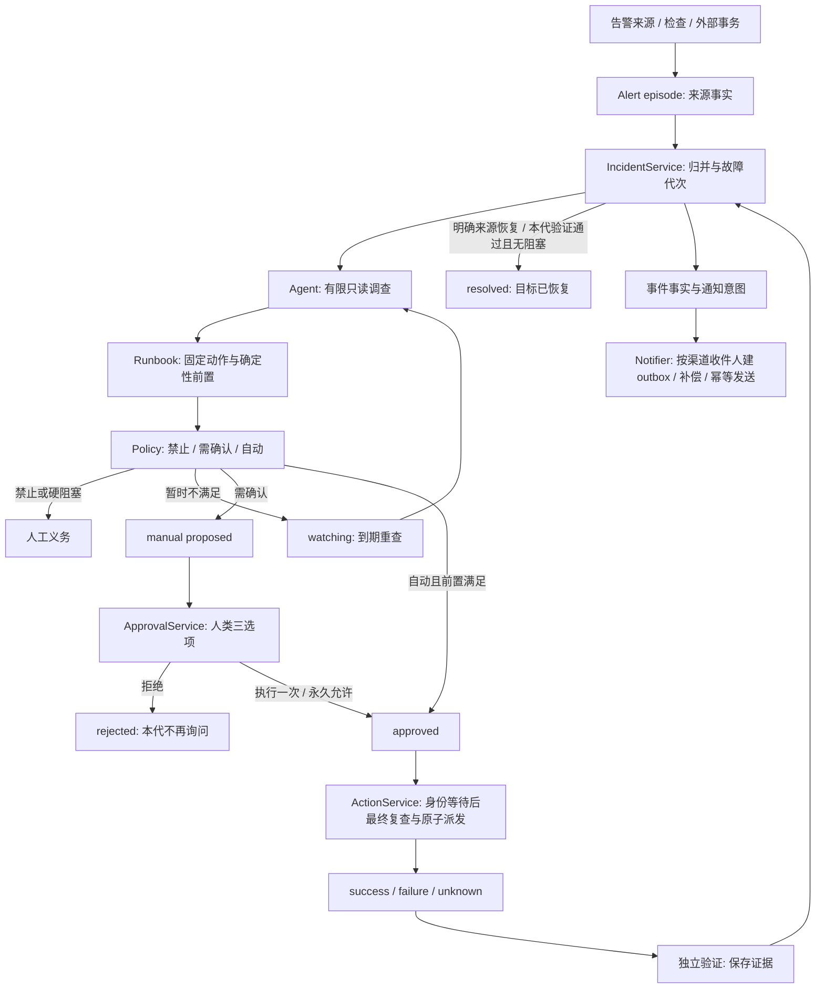

# 事件处置链路与本次收拢

2026-10-21。本次从现有实现出发处理状态冲突，没有替换数据库或重写状态机。配置、密钥、历史数据和既有执行限制保留。实际部署和验收结果在文末记录。

## 完整链路

## 状态所有权

| 模块 | 权威事实与职责 | 与下游的约定 |
| --- | --- | --- |
| `alertmanager.py` 等来源适配器 | episode 的 firing/resolved、来源可用性、来源隔离 | 未见目标或来源不可用不等于恢复；新问题交给 IncidentService |
| `incidents.py` | Incident 的 status/stage/generation、并行人工义务、恢复/关闭 | 复发开启新代，旧动作和验证不能改变新代；人工关闭与确认恢复分开 |
| `investigation.py` | 有限只读证据、事实与假设 | LLM 建议不能授权或决定任意命令 |
| `runbook.py` | 固定能力、匹配条件、结构化阻塞、统一派发预算 | 临时阻塞带理由和 retry_at；不产生人工批准权 |
| `policy.py` | allow、require_approval、auto_allowed、目录和 Agent ceiling | 三态只说明权限；与冷却、通道和业务恢复分开 |
| `agent.py` | 当前代的调查、等待、提案、自动编排 | 不直接派发命令，不直接提交执行结果；通知失败不反向改变动作结果 |
| `approval.py` | 人类三选项、无歧义选单、精确永久授权与批准同事务 | 消息、Web 新旧即时审批入口共用；保留真实人类身份 |
| `actions.py` | 操作状态、批准/拒绝审计、最终安全门、派发领取、执行与验证义务 | approved 才可领取；dispatched/unknown/终结态不重放；身份等待后重新核验 |
| `notify.py` | 通知意图、原收件人快照、逐渠道 outbox、重试与补偿 | 不决定 Incident/Action；实时与补偿使用同一事件及静默决定 |
| `main.py` | 装配和调度 | 排除尚未到期等待及当前代已有操作，避免旧事件占满名额 |

## 四类决定不再混合

| 情形 | 结果 | 下一跳 |
| --- | --- | --- |
| 冷却、滚动日预算、缺新鲜失败探测、普通锁、暂时通道/来源不可用、全局暂停 | open / watching，无新人工提案 | 到期自动重查；保留理由与时间 |
| 权限允许但需人确认，或自动开关关闭 | manual / proposed + awaiting_approval | 三选项；不把冷却描述成没权限 |
| 显式禁止、控制面自动操作、隔离来源、缺验证契约、结果未知写入 | 人工处理或拒绝 | 不通过永久允许覆盖禁止或重放未知命令 |
| 自动权限与开关均开启，前置满足 | auto 提案、批准、最终复核后执行 | 独立验证和来源恢复收敛 |

## 人类授权

- **执行一次**：批准并执行当前一条操作；长期权限不变。
- **不执行**：拒绝并审计；清除这条待批义务，保留本代拒绝事实，避免反复打扰。
- **永久允许执行**：要求明确管理员、现有效 allow、目录及 ceiling 允许自动、非控制面；只将同一 Agent、能力、资产、对象的 auto_allowed 设为真、require_approval 设为假，随后执行当前操作。

Policy 的三态要求 auto_allowed=true **且** require_approval=false 才会 automatic，因此永久决定必须同时改变这两个自动确认字段；allow 的禁止项不变。权限变更及批准同一短事务提交，执行前仍重新核验。

QQ 管理员使用既有 admin_qq，Web 使用已认证 session 的 is_admin。企业微信管理员可在 Web → 消息渠道 → 对应智能机器人 → **管理员（可选）** 配置：选择本渠道观察到的发送者 UserID，也可手填或清空；名单存于该渠道的 `config.admin_user_ids`，默认空。读取/保存要求 Web 管理员，保存校验 CSRF 并审计；实际入站以受信的 channel_id 核对，禁用渠道立即撤销其资格。原显式 `admin_wecom_users` 配置保留兼容。

管理员资格不会绕过该人对实际操作对象的执行权限。未配置企业微信管理员时永久决定会拒绝；Web 可正常处理。普通一次执行/拒绝仍使用各消息主体的既有权限。多个待批操作时不能猜最新一条，需到对应事件选择。名单不会将观察到的成员自动选中，也不会自动写入任何执行权限。

## 本次实际修复的冲突

1. automatic 遇到冷却被降为 awaiting_approval；改为结构化等待并自动重查。
2. Agent 从 audit_log 算预算、Action 从 actions 算预算；共用按实际派发时间计算的 `auto_budget_state`，unknown 同样占预算。
3. Agent 用对象短名查锁、Action 用规范对象 ID；统一绑定。窗口内旧失败也不能盖过最新恢复探测。
4. 已批准操作在身份核验期间可能已恢复、换代或换对象；批准与最终派发共用当前 Incident 有效性检查，终态撤销尚未派发的 approved/proposed。
5. 批准后执行前被阻挡留下 approved 却没有下一跳；人工操作建立 execution_blocked 义务，Web 提供继续执行；领取成功只核销这条义务。可重试的自动阻塞取消未派发操作后回到等待。
6. 旧验证失败可能重开已恢复事件或污染新代；验证保存证据，统一交 `on_verification_finished` 处理当前代，人工关闭和来源确认恢复不被迟到结果撤销。补建验证沿用动作所属代次。
7. 验证失败不会无限自动重启同一故障；当前代保留人工义务。真正恢复后复发进入新代并清旧义务，可重新自动处置。
8. 授权/等待/升级通知没有补偿义务；改为事件驱动，与自动完成通知共用事件 outbox。通知异常不能将已成功执行改成人工故障。
9. 一小时静默只在部分实时路径判断，补偿可绕过；静默决定随事件持久化，同 episode 的新事件不错误重置判断基线。
10. 过期授权、已被执行接管的等待、被其他义务替换的升级消息可能迟发；补偿和发送前核对当前代、具体动作或具体人工原因。
11. 无渠道时发生的当前事件可明确标记延后；以后新增渠道补发该义务。补偿不能替旧历史补造此标志，已通知事件的收件人快照不随新增渠道扩张。
12. 实测发现旧 resolved episode 被后台重放后清理了新代的 not_seen，且恢复事件按旧 episode 去重而遗漏。本代恢复入口现核对 episode 归属，旧恢复不能清理更晚出现的问题；`ensure_recovery_event` 以故障代次幂等记录恢复事实。后台与实时复用同一关联/恢复入口，旧代不占处理名额。同批多个告警的关联事件补齐 episode_id 列，并兼容旧版 payload，最后恢复的附加告警也能正确闭环。
13. 操作已成功并等待验证时 Incident 仍可能显示 pending。现由 reconcile 根据当前动作、验证与人工义务推导 executing / verifying / awaiting_approval / watching / need_human，迟到调查也统一检查启动时的事件代次与状态。
14. 企微未连接、未认证等完全未发出的消息曾被当作结果未知而永久失败。现明确未发送可重试；写帧异常、回执超时或发送后断线仍结果未知，不自动重发。旧版直接发送的 Agent 历史事件不会被新增补偿错误当作新告警回放。

## 为什么仍保留两次安全检查

Agent 的前置用于编排与解释；Action 的检查紧邻真正派发。两者之间存在调查、人工等待、身份核验等异步间隔，权限、来源、对象、锁和暂停状态都可能改变。因此保留最终复查，但把三态、预算、当前事件有效性和义务核销收拢为共享定义，不维持两套互相矛盾的规则。

不做旧 manual 提案的全局自动迁移：自动开关关闭也能合法产生 automatic 策略的人工提案。历史错误操作由明确来源恢复自然撤销，不能仅凭策略快照批量取消或执行。

## 验证记录

所有现网操作经规定的 KANATA Next Terminal；没有直连目标 IP。整包只同步 `ayana/*.py` 与 `static/`，共 54 个源文件；部署前备份源码、逐文件核对哈希，最终 54/54 一致，服务与 HTTP 健康检查通过。配置、密钥、数据库、虚拟环境未被安装包覆盖。最终源码备份为 `/opt/ayana/.source-backups/remediation-20261021T135037Z.tar.gz`。

第一次真实停机（北京时间）：

| 时间 | 验收证据 |
| --- | --- |
| 17:03:16 | 停止 nerv 的 frps；Prometheus 探测为 0 |
| 17:06:55 | TargetDown 进入 firing，事件开启第 5 代 |
| 17:07:07 | Action 以 mode=auto 成功执行重启，无人工批准；企微「自动处置」通知 sent |
| 17:09:07 | 独立 svc.recover 验证 passed，连续 90 秒成功，7 个样本、间隔不超过 20 秒 |
| 17:09:25 | 事件 resolved/done，need_human=0，理由「目标已恢复」；frps 保持 active |
| 17:18:35–17:19 | 上述验收暴露的旧 episode 漏恢复事件问题修复后，用幂等接口为已验证恢复的本代补齐事件并审计；企微「已恢复」通知 sent，正文使用本次 17:06→17:09 时间 |

第二次在冷却内停机，没有缩短冷却或提高每日上限：

| 时间 | 验收证据 |
| --- | --- |
| 17:18:40 | 再次停止 frps，等待真实 TargetDown 触发 |
| 17:22:48 | 第 6 代进入 watching/等待，企微通知「冷却中，下次可执行时间 17:37」，未形成需要批准的人工提案 |
| 17:37:33 | 冷却到期后自动创建并完成 auto 动作 |
| 17:39:33 | 第 6 代独立验证 passed，连续 90 秒成功，7 个样本 |
| 17:42:10 | 第 6 代目标已恢复，事件 done、need_human=0，本代恢复事件存在；自动处置与恢复通知均 sent |
| 21:47 | 继续任务后核对以上持久记录，确认 frps active；启动命令保持其运行 |

第二轮实时恢复通知仍取了事件最初创建时间；最终修复为实时和补偿都使用恢复事件保存的本代文案快照，并通过专门回归。第 6 代事件快照为本次 17:22→17:42，未为文案修改重发已送达通知。

最终滚动 24 小时自动派发预算为 3/3，下一额度约在 **2026-10-22 16:15:16 北京时间** 释放。未修改权限、冷却或额度以使测试通过。

人工三选项、权限禁止/控制面/歧义、渠道管理员与网页安全通过本地真实数据库和假运输集成验证；未冒用任何真人账号向企微发送授权答复。企微管理员由用户在新增 Web 入口选择。

最终完整回归：`python -m unittest discover -s tests -p 'test_*.py' -q`，**1039 项，0 失败、0 错误，2 项按既有条件跳过**。网页交互：管理员配置 4/4、三选项审批 8/8、既有安全交互 21/21；Python/JavaScript 语法及 diff 空白检查通过。测试细节见 `agent-remediation-notes.md`、`approval-action-notes.md` 与新增的审批、通知、状态一致性回归。

最后两处整合回归曾暴露非来源确认恢复的验证失败义务写入顺序、私有升级接口测试调用未同步；均已修正后重新跑完整回归，以上计数为最终源码结果。现有暂存与未提交改动均保留，本次未提交 Git。
